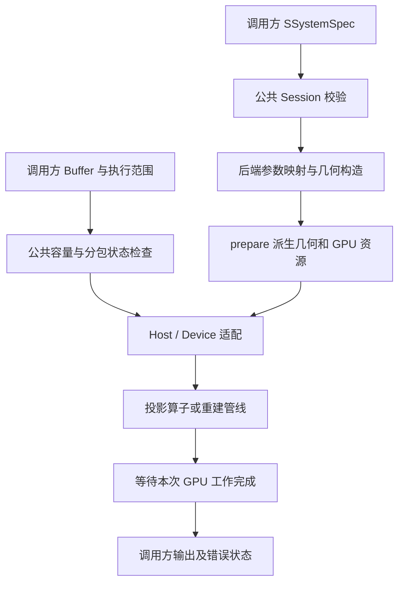

# 架构与开发

本篇面向修改本体库的开发者。SDK 用户从 [公共 API](public-api.md) 开始；几何真值见 [几何与数据](geometry-and-data.md)，算法公式与差异见 [算法](algorithms.md)。

## 模块与依赖边界

| 位置 | 职责 |
| --- | --- |
| `include/YKCBCT/geometry` | 安装的几何类型、builder、刚体变换与体素网格 |
| `include/YKCBCT/algorithms` | 不持有 CUDA 工作区的公共算法参数 |
| `include/YKCBCT/interface` | 公共 Session、请求、错误、系统配置聚合 |
| `src/interface/YkReconstructionApi.cpp` | 版本/容量/状态/组合检查、公开错误与同步契约 |
| `src/interface/YkSession.cpp` | 实际后端选择、参数映射、Host/Device 适配、执行/释放 |
| `src/common` | PreparedGeometry、ResourceContext、工作区、投影算子和共享 CUDA 类型 |
| `src/global` | 内部参数、日志、RAII 内存、纹理与 launch policy |
| `src/Filter` | FFT、卷积、频域权重和空域 ramp 构建 |
| `src/FlatFpBp` / `src/CylFpBp` | 保留各自几何和数学模型的 FP/BP；Cyl 另有迭代与解析适配 |
| `src/Reconstruction/Analytic` | 圆轨迹 FDK/xFDK/C-FDK 与螺旋 wFBP 管线 |
| `src/Reconstruction/Iterative` | Flat 与 Helical 迭代门面、公共内部调度与正则 kernel |
| `src/NonStandardFpBp` | SourceOrbit、NikonTilted、专用轨迹与 stage |
| `src/DLTFpBp` | 标定矩阵投影、反投与代数重建内部实现 |
| `Yktest` / `unit_test` / `dlltest` | 内部数值、轻量组件、公共 DLL 三种测试边界 |

`src/` 是内部实现，不随 SDK 安装。`ETask`、旧代数适配器、内部资源和 launch 不属于公共 API；不能为了第三方调用方便把 include 搜索路径指到整个 src。公开算法参数头可独立包含，完整系统几何仍依赖 CUDA 向量类型。

## 请求数据流

规则系统从一次 builder 输出生成全部逐视图 geometry。每次 execute 只选择完整序列或允许的连续范围，不再提供另一套角度。非标准轨迹在 initialize 选择专门准备和管线。

同名参数从 SDK 到后端必须逐项映射并测试；不要只修改 public struct 后认为功能已经开放。当前已声明未消费的字段见 [API 参数消费表](public-api.md#系统参数)。

## 构建归属与 device-link

顶层创建单一 `YKCBCT SHARED`，子目录通过 target_sources 向它追加正式源码。CUDA separable compilation 在主目标开启，正式 CUDA 实现统一归属主 DLL，避免拆散后 MSVC/CUDA device-link 对象丢失。

Yktest 直接验证内部 kernel，复制主目标实现源码并自行 device-link，排除公共 Session 导出及库 anchor；它不是先链接 DLL 再重复编译同批实现。DLL 测试仅链接 `YKCBCT::YKCBCT`，不访问内部重建器。unit_test 只编译轻量组件，当前仍通过整个工程配置，因此配置阶段仍需 CUDA 工具链。

新增源文件先接入所属子目录 CMake，再检查主 DLL 和 Yktest 的来源、条件编译宏以及开关关闭时的行为。测试 CUDA 源码放 `Yktest/cuda`，不得编进正式库。

## 几何准备与资源生命周期

PreparedGeometry 保存算法实际使用的几何，ResourceContext 管理 GPU/stream，DeviceWorkspace 与 RAII Buffer 管理工作区。prepare 应完成合法性检查、逐视图派生量、纹理规格与生命周期准备；launch 不重复处理宏观采集 offset。

FDK 必须区分标称采集参数、实际 vector geometry、stage 派生几何。外部校准 geometry 的主点与距离要从实际向量计算，不能被标称值覆盖。Flat/Cyl 不能共用会丢失曲率语义的转换。

Session reset 保留几何和可复用资源，清除算法执行状态；release 销毁完整后端、scratch、纹理与 stream。资源释放前需确保异步工作不再引用资源。公共 execute 成功返回前同步；内部 apply/launch 可以异步，不能逐 kernel 强行同步破坏吞吐。

Host 传输 scratch 应按容量扩展，使用后端 stream 保证上传→计算→下载顺序。cudaArray 是线性内存的快照：源数据变化后必须显式更新，不能假设纹理对象自动跟随。

SourceOrbit/NikonTilted 的内部逐包输入共用 NonStandardFdkStreamingState 校验视图顺序与容量，各管线保留自己的暂存和数学处理。enqueueBatch 同步消费后才推进计数，输入可立即复用；计算失败使当前流失效，需要 cancel/prepare 恢复。输入指针偏移必须采用包内索引，重采样 map 和派生几何偏移采用全局索引；完整 process 复用同一执行路径。接口与内存界限见 [内部流式契约](algorithms.md#非标准-fdk-内部流式契约)。

Cyl Analytic Reconstruction 以固定大小原始/平板 chunk 实现逐包映射并复用 Flat FDK 的在线几何位置，不保存完整映射投影。ProjectionMapper.applyBatch 只调整本包视图数，映射参数保持 prepare 的规范化结果。旧 CylFdkPipeline 委托同一实现。FdkProjectionBatch.location 默认 Host，Device 批次显式使用 DeviceToDevice 复制，输入生命期持续到同步消费或 fence 完成；内部 Device 扩展不改变 Session 的缓冲区限制。

本次自然流式范围已完成。C-FDK、wFBP 和迭代后端保留各自完整输入和状态机，不列为待补的逐帧流式入口；FP/BP 也未因本次变更新增统一流式门面。完整状态见 [流式范围](algorithms.md#流式范围与当前完成状态)。

## CUDA 文件与 launch 约定

共享类型位于 [YkOperatorKernelTypes](../src/common/cuda/operators/YkOperatorKernelTypes.cuh)，采样 reader 位于 [YkSamplingReaders](../src/common/cuda/operators/YkSamplingReaders.cuh)。按 Joseph/Siddon/FDK 数学语义分文件，兼容聚合头不再承担新的实现。

launch 的固定职责：

1. 兼容 bool accumulate 转成 `CudaOp::EWriteMode`。
2. 覆盖模式下为原子累加输出在同 stream 清零，使用 clearIfOverwrite。
3. 按 view、纹理深度、grid 限制分包。
4. 选择数学模板、采样倍率及 launch policy，发射 kernel。
5. 最后进行 CUDA kernel 错误检查。

参数验证、几何构造、资源生命周期归属 prepare/context。launch 防零长度发射及硬件维度越界。新的 kernel 内使用 EWriteMode，禁止含义不明的 accumulate bool。

FP 通常每线程独占一个探测器像素，可覆盖或累加；RayDriven BP 原子写回，覆盖前必须清零；VoxelDriven BP 每线程独占体素。分包只在包边界转换写入模式，后续包累加；清零与计算使用同 stream。

## 纹理与读取契约

| 用途 | 读取方式 |
| --- | --- |
| 精确线性投影对照 | RawProjectionPointReader |
| 离散投影采样 | TextureProjectionPointReader，Point |
| Siddon 体积读取 | Point，保持离散体素值 |
| Joseph 体积插值 | Linear，硬件插值权重有量化 |
| 解析/连续 voxel-driven 投影插值 | 对应 Linear reader |

所有外部空间边界采用 Border/零；禁止 Clamp 伪造体积或探测器边界外数据。纹理坐标与像素中心的半像素转换由 reader/调用约定统一处理，不能在多个 kernel 重复修正。Point 精确读回与 atomicAdd 顺序差异是两类不同误差。

同一 kernel 支持多种存储时用编译期 Reader 模板，不同时传 raw 指针、纹理和运行时 use_texture 开关。纹理元数据包含尺寸、过滤和地址模式，应在算子准备/调用时验证。

超长视图序列首先可能触及 MaxTexture3DDepth；不能只检查 grid.z。纹理/视图分块必须由上层明确管理，kernel 内 grid 分包不能补救已超限的纹理分配。

## 主轴、单位与超大数据

- 世界到体素坐标统一使用 normalizeToVoxel/normalizeToVoxelBatch；体积中心和各向异性间距必须保留。
- 主轴从源→探测器中心射线派生，Flat Joseph 用 forEachAxisRun 合并连续同主轴视图。
- AxisX/Y/Z 只负责坐标排列，物理积分和算法权重仍由具体模型决定。
- 一维数组使用 SKernelLaunchPolicy::make1D 和 grid-stride loop；尺寸计算先转 size_t 防止乘法溢出。
- view 放 grid.z 的 kernel 按 maxAngleChunk 分包；分别说明纹理内 view_offset 与设备 geometry 指针偏移。
- 分包几何必须对应输入包的同一视图，不能借另一份角度重新推测。

## inline 与源码组织

头文件适合类型、模板和短 inline helper；跨编译单元调用的 host launch 在头中声明、在 `.cu` 中定义。不要在多个翻译单元包含非 inline 的同名函数定义，也不要仅凭加 inline 解决所有 CUDA 链接问题。

跨 CUDA 翻译单元的 device 调用需要与 separable compilation/device-link 配置一致。文件名按 `JosephRayDrivenBp`、`SiddonRayDrivenBp`、`FdkBp` 等语义命名；v2/v3 只保留兼容入口，并注释实际采样/算法差别。

旧适配器只在仍有调用或回归价值时保留。整段注释旧 kernel、重复 include、开发过程叙述和无来源性能断言应删除；历史由 Git 保存。

## 内部迭代门面

Flat 的 AlgebraicReconstructor/Ex 将方法、权重、子集顺序、TV、收敛分离；CglsReconstructor/Ex 将策略与几何入口分离。旧 SIRT/SART/OSSART/CGLS 适配器保留内部源码兼容，不等同于安装 SDK 兼容别名。

Helical Flat/Cyl 门面接受完整逐视图 geometry；源 z 位置由 builder 决定，不允许重建器从标称角度重新生成圆轨迹。它们复用各自 Flat/Cyl 算子，不执行 C-FDK 曲线重排、余弦预加权或解析深度权重。

扩展正则化时保持数据更新、先验、调度和约束职责独立。外循环完成后执行正则，内部子集增量入口只做数据更新；正确处理实际子集数与统计。CGLS、PWLS、TIGRE 各有独立状态机，不能因字段同名强行共用更新。

## 新功能接入顺序

1. 明确物理输入、离散模型、量纲、几何限制及 FP/BP 伴随目标。
2. 接入内部类型、prepare/precompute、资源、launch 与 pipeline。
3. 添加有数学期望值的数值测试，验证资源释放和不支持条件。
4. 如需公开，更新 SDK 参数、枚举、版本/尺寸处理、放行判断与每项后端映射。
5. 添加仅用安装头文件调用的 DLL 测试，包括容量、位置、范围与状态错误。
6. 更新本篇相关边界、算法支持矩阵和验证记录，验证开关开/关构建。

最低检查按改动选择 [验证矩阵](testing-and-validation.md#按改动选择验证)。不要仅用图像相关系数验收尺度，不要仅编译内部 Yktest 就宣称公共 DLL 可用。

## 文档的单一说明位置

公共生命周期/参数在 API 文档，坐标/布局在几何文档，算法支持/公式在算法文档，构建在接入文档，测试命令/证据在验证文档，本篇只定义开发边界。修改代码时同一提交更新相关主说明，其余文档链接引用；避免在源码目录 README 再维护第二份算法规范。
