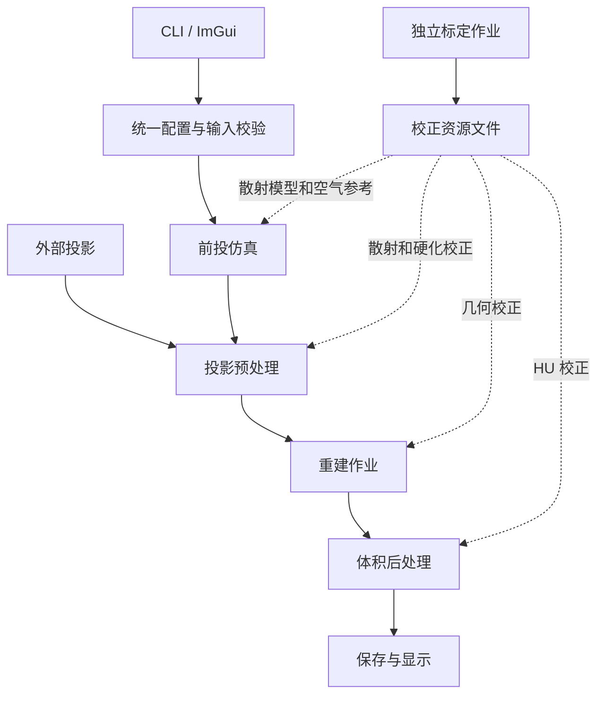
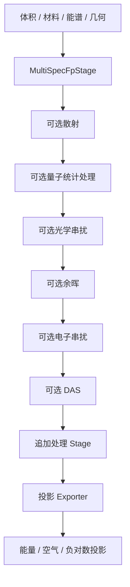
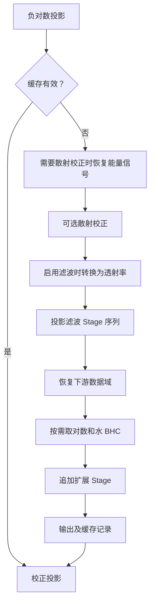
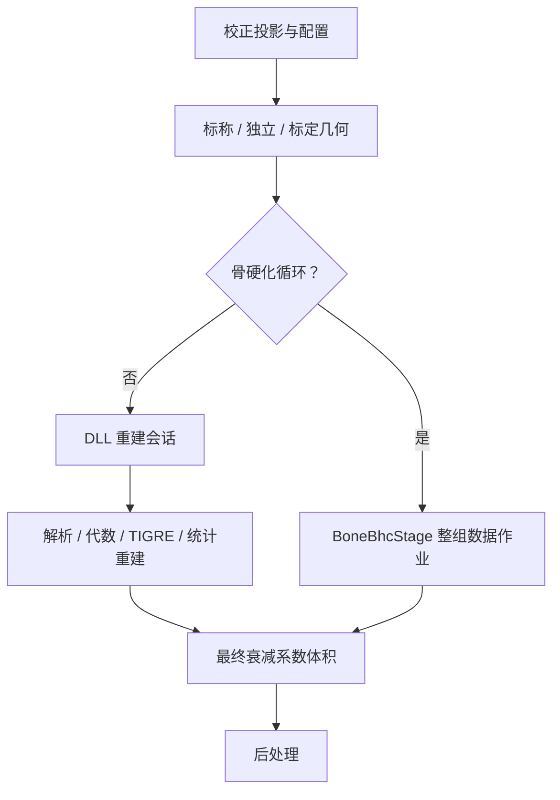
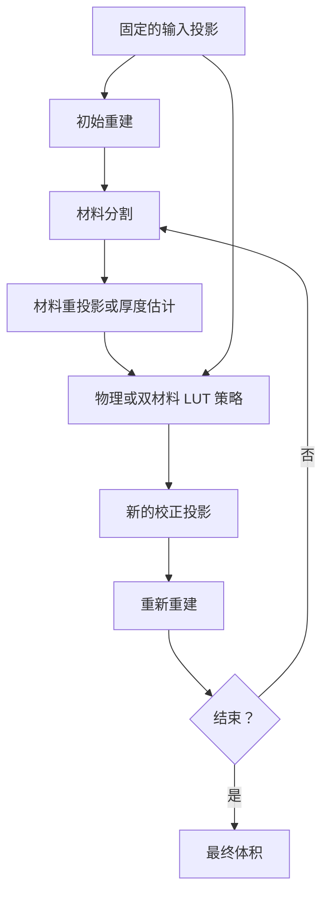
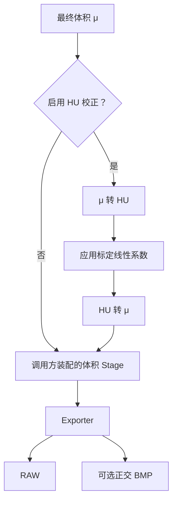
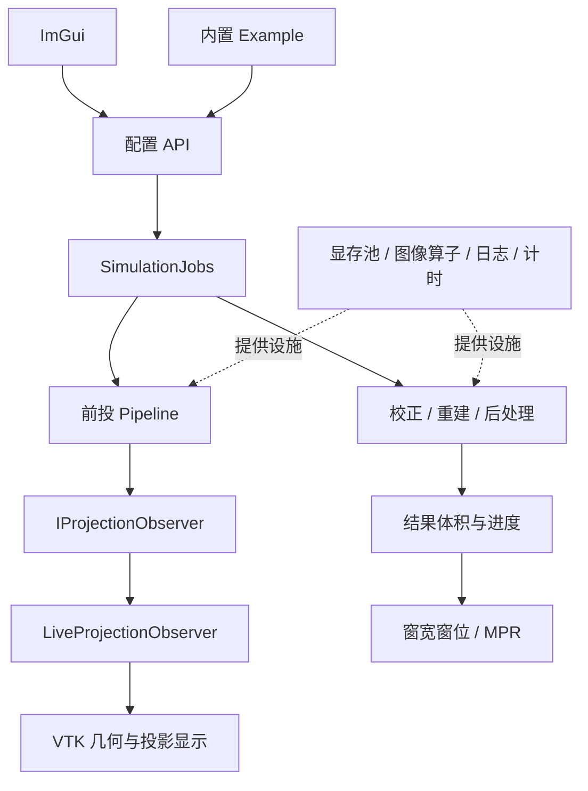

# 源码组织

`include/` 保留五个公共接口分区。应用实现放在 `src/` 的对应分区；具有独立 API 或可选显示边界的组件集中到 `modules/`。目录分区本身不要求建立独立库。

```text
include/                         公共接口按业务用途查找
├── input/                       准备输入
│   ├── calibration/             标定作业及校正资源读写
│   ├── config/                  TOML、参数及谱文件读取
│   ├── materials/               材料、XCOM、水参考与多能谱模型
│   ├── io/                      体积数据读写
│   └── examples/                内置模体和数据示例
├── projection/                  生成投影
│   ├── spectral/                标签体积多能前投、采样、探测器仿真
│   └── scalar/                  浮点体积前投
├── recon/                       重建与校正
│   ├── backend/                 重建 DLL 适配
│   ├── preprocess/              投影校正、缓存、BHC 标定
│   ├── bhc/                     骨硬化策略与迭代作业
│   ├── postprocess/             体积后处理与输出
│   └── geometry/                几何标定与校正
├── processing/                  跨前投和重建复用的处理设施
│   ├── stage/                   Stage 接口、执行结构、插件元信息
│   ├── image/                   滤波、重采样等图像运算
│   ├── scatter/                 仿真和校正共用的 ASKS 运算
│   ├── device/                  设备缓冲与显存池
│   └── support/                 日志与任务进度
└── client/                      界面与交互
    └── panels/                  ImGui 面板
```

私有实现按同一职责归属，静态组件见 [modules 说明](modules/README.zh-CN.md)。例如浮点前投接口在 `include/projection/scalar/`，实现和构建入口在 `modules/scalar_projection/`。只有接口而无实现时，不建立空的 `src` 对应目录。

## 边界

- `input` 提供配置、体积、材料和谱，不依赖界面。
- `projection` 生成投影；`spectral` 与 `scalar` 是同一级的两种前投实现。
- `recon` 调用底层重建 DLL，组织校正和重建作业。底层 DLL 不反向依赖本应用。
- `processing` 放跨流程复用的 Stage 和运算设施，不接管前投或重建算法。
- `client` 装配交互和显示。可选 VTK 组件仍独立放在 `modules/visualization/`，便于关闭界面构建。

`app/` 放可执行入口，`app/experiments/` 放实验程序，`app/plot/` 放绘图工具。BHC 用法示例在 `include/recon/preprocess/examples/`，内置模体在 `input/examples/`。配置、输入资源和构建输出分别放在 `configs/`、`inputs/`／`spectra/`、仓库 `out/`。

Stage 是头文件契约；显存池、图像处理、自适应散射深度参与设备状态及处理流程，作为 `processing` 内部实现直接编译进使用者。三者的源码列表集中在 `cmake/ProcessingSources.cmake`，函数只装配源码与编译依赖，不创建库目标；重复接入同一目标不会重复添加源码。自适应散射的实验开关保留。可插拔 Stage 是运行时的处理策略边界，不要求每种策略对应一个静态库。

## 文件与构建约定

公开头文件和私有实现按上述分区对应放置。引用公开接口写完整路径，例如 `#include "input/materials/WaterReference.hpp"`；私有辅助头文件跟随实现。新增功能优先加入已有分区，只有形成独立职责后才增加子目录。根目录不堆散文件，也不为单个辅助类新设顶层目录。

根 `CMakeLists.txt` 负责选项、依赖查找和独立组件，随后依次加载 `Application.cmake`、`Tools.cmake`，开启测试时再加载 `Tests.cmake`。应用源码和内部目标统一在 Application 定义；工具与实验在 Tools；测试在 Tests，不再由测试文件给主程序补源码或依赖。源文件显式列举，不递归搜集。

`cmake/` 只保留上述三个职责文件，以及三份有明确复用目的的文件：`ProcessingSources.cmake` 装配内部处理源码，`NumericalTests.cmake` 供完整构建和独立测试入口共用数值测试，`Findmatio.cmake` 查找 SDK。新增业务分区通常只修改 Application 中的源码列表；新增测试修改 Tests 或共用数值清单，无需再新增一个 CMake 片段。

`tests/` 按相同的五类职责分组，参考数据在 `tests/reference/`；`tests/cpu/` 保留无需 CUDA、VTK 或重建 DLL 的独立测试入口。可执行程序名和 CTest 测试名不随目录调整变化。

移动接口直接更新引用，不保留旧路径转发头。同步检查主构建、独立测试、实验程序、工具和文档；目录调整不改变算法或默认参数。

## 配置、计算与界面的调用边界

配置入口统一在 `input/config/SimConfig.hpp`，CLI 与 UI 使用同一套规则：

- `loadConfig` 负责 TOML 语法、字段读取和相对路径解析，再调用公共校验。
- `normalizeConfig` 补全派生默认值，例如从前投输出继承校正空气图路径。
- `validateConfig` 检查内存参数，不访问输入文件；实现集中在 `ConfigValidation.cpp`。
- `validateRuntimeInputs` 在执行前检查所需校正模型等外部资源。体积和投影内容、大小仍由各输入读取器检查。
- `saveConfig` 在 `ConfigSerialization.cpp` 从当前参数生成完整配置，不依赖原配置文件仍然存在，不读取原文件合并旧字段。

UI 的参数编辑不再通过临时 TOML 往返完成校验。新增参数时，在配置层补齐解析、校验和序列化，再添加界面控件。前处理参数表的序列化集中在私有 `PreprocessConfig.hpp`，保存配置和校正缓存身份共同使用；缓存另附输入文件时间、大小以及相关谱、空气图、模型文件身份。更改重建算法不会因此重新做投影校正。

前投核心不包含 VTK、ImGui 或 client 接口。`IProjectionObserver` 是可选的观察接口，按准备、轨迹、逐帧、进度、完成顺序通知；成功和失败均调用 `reset`。数据只在回调期间借用，回调在调用线程执行。`FrameGeometry` 是独立的几何描述，VTK 只是使用者。

`client/LiveProjectionObserver` 将上述通知适配到 `LiveView`；拥有的窗口由适配器清理，外部传入的窗口只借用。CLI 在 `app/main.cpp` 选择普通前投、带显示前投或交互模式，前投算法内部不再决定是否启动界面。

`client/SimulationJobs` 管理成功计算后的配置快照、扫描切换时的失效、后台重建、进度副本与异常结果。界面负责绘制和用户交互；VTK 更新仍在 UI 线程执行。重建工作结束后必须领取结果才能启动下一个任务，析构等待工作线程结束。它是具体的应用控制器，不是通用任务框架。

重建适配入口统一命名为 `reconstructWithLibrary`，覆盖解析、代数和统计重建。应用自己的计时、显存预算估算与批量策略放在应用内，不再包含 DLL 私有 `common` 或迭代实现头；调用底层算法仍经其公开接口。

非标准几何的纯计算工具也属于 SDK 公共几何层：`YkTrajectorySampling.hpp`、`YkNonStandardViewGeometry.hpp`、`YkSourceOrbitGeometryBuilder.hpp` 和 `YkTiltedAxisGeometryBuilder.hpp` 位于 `include/YKCBCT/geometry`，随 SDK 头文件一起安装。应用的 `LibraryGeometry` 仅将配置转换为公共几何描述，不包含 `src/NonStandardFpBp`；DLL 与应用使用同一份几何公式。裁剪窗口、重采样和重建算法仍在底层私有实现中。旧私有头文件已迁移，没有兼容转发层。

`multispectrum_pose_unit_test` 只使用 SDK 公共头文件与 CUDA 基础类型，不链接重建 DLL、不包含底层 `src`，验证平面源轨道、探测器姿态、倾斜轴和螺旋几何的一致性。应用及内部处理源码装配不再添加底层 `src` 搜索路径。日志使用仓库内 `thirdparty/spdlog` 的固定版本，以 `yk::spdlog` INTERFACE 目标显式私有依赖；应用不再搜索底层 `src/util`。该目标只提供头文件，不产生静态库或运行时 DLL，SDK 公共接口不暴露 spdlog 类型。底层算法白盒测试可继续包含私有头文件，不能据此给生产目标增加相同路径。


## Stage 与业务实现的关系

`processing/stage` 只提供插件元信息结构、契约、注册和执行设施。内置业务描述集中在 `processing/PluginCatalog.hpp`，不让通用接口反向认识各个业务。图像运算位于 `processing/image`；与重建数据绑定的 Stage 适配位于 `recon/ImageStages.hpp` 及对应实现。增加独立滤波算子和增加某条流程中的 Stage 是两种不同的修改入口。

这些边界不需要额外的工厂层、模板参数或独立静态库。新增功能先找到已有职责和处理链，再决定是否需要新类型；不要仅为了目录对称或每个类单独编译而增加层级。

## 标定与校正的分离原则

标定作业生产可保存的校正资源；正式处理链加载资源并应用。标定不属于每次预处理、重建或后处理都隐式执行的步骤。仿真可提供一键生成，但应明确显示为准备作业，并把结果保存下来供后续重复使用。

| 标定产物 | 使用位置 |
| --- | --- |
| 水 BHC 多项式或查找表 | 投影域水硬化校正 |
| ASKS 模型 JSON | 散射仿真或散射校正；二者共享模型，不共享标定作业 |
| 双材料骨硬化表 | 对应骨硬化策略，按其要求的输入数值域应用 |
| 几何标定结果 | 解析为重建几何，进入重建适配器；不是逐像素滤波 |
| 空气参考及相应尺寸、采集条件 | 归一化、取对数及需要空气参考的散射校正 |
| HU 线性标定系数 | 重建体积的 HU 校正 |

产物应记录格式版本、数值域和单位、适用采集条件、有效范围及来源。各资源保留自己的类型和格式，不强制塞进一个万能表结构。资源加载器检查格式和适用性；Stage 使用已加载的只读模型。校正缓存应包含所用资源的身份；更换资源必须使旧缓存失效。标定也可以使用 Stage，但运行在独立的标定任务里。

当前实现：水 BHC 拟合位于 `input/calibration/WaterBhcCalibration`，预处理仅调用 `WaterBhcTable` 的加载/解析；未准备好的拟合请求会明确报错。几何标定分别输出诊断 JSON 和可加载的校正 TOML；HU 标定结果可保存为 TOML，并由 HU 校正 Stage 从文件构造。双材料表、ASKS JSON 和空气 RAW 继续沿用现有加载器，不在校正时生成。

水 BHC、几何和 HU 的校正文件 I/O 集中在 `src/input/calibration`。各资源保留具体类型，没有增加泛型资源工厂。水 BHC 表更换会使投影校正缓存失效；几何表加载检查当前采集尺寸，保留当前重建网格。空气 RAW 仍使用一帧广播或逐视角布局，读取时检查文件长度和正有限值；尚不包含独立的采集条件元数据，使用者需保证与对应投影同域、同剂量和同探测器响应。

### CPU 数值求解

通用线性代数使用 `Eigen3::Eigen`，不再维护手写 QR/高斯消元：水 BHC 在归一化的 Vandermonde 矩阵上用带列主元的 Householder QR 求最小二乘，并检查秩；双材料标定的阻尼正规方程和 EBHC 的加权二阶系统使用 LDLT。模型、Huber 权重、阻尼与收敛策略仍由具体标定方法负责，不能把线性求解器当作完整优化算法。

Eigen 是相关 CPU 实现的私有头文件依赖；配置结构、Stage 接口和 CUDA kernel 不暴露 Eigen 类型。完整应用在上层查找 Eigen 目标，几何标定和数值拟合共同复用。独立 CPU 测试通过 `find_package(Eigen3 CONFIG REQUIRED)` 获取 SDK，可设置 `Eigen3_DIR` 或 `CMAKE_PREFIX_PATH`；不硬编码本机安装路径。

## 当前业务链与 Stage 清单

以下区分默认装配、可选配置和仅通过 API 装配的能力；“有 Stage”不代表它已进入所有 TOML/UI 入口。标定资源的具体格式和读取方式见 [校正资源文件说明](CALIBRATION-ARTIFACTS.zh-CN.md)。

### 总体关系



标定生产可复用的资源，执行链读取资源。两者可复用物理模型、图像算子、Eigen 求解和数据接口，但正常执行不能隐式重新标定。水 BHC、几何和 HU 的文件读写在 `input/calibration`；双材料和 EBHC 的专用拟合靠近对应业务，仍在 `recon/preprocess/calibration`。这不是所有标定都已集中为同一个 UI 工作台。

### 前投



| 部分 | 实现边界 |
| --- | --- |
| MultiSpecFpStage | 实现 ISource，准备物理输入并生成批量投影 |
| 射线采样、焦点/散焦、路径遍历、多能积分、探测器响应 | Source 内部 Backend 的融合计算，不拆成独立 Stage |
| Scatter / Quantum / Crosstalk / Afterglow / DAS | 可选 IProjectionStage；光学和电子串扰是两个执行环节 |
| 量子噪声 | 主射线采样部分已融合在前投 kernel；后续 Quantum Stage 选择/补充统计结果，不能理解成全部噪声只在此生成 |
| 能量、空气与负对数输出 | Exporter |
| 显示通知 | IProjectionObserver，不是数值 Stage |

主路径可保持设备数据；Host 数据接入并不保证所有物理算子都有纯 CPU 实现。独立 `scalar_projection` 提供浮点体积前投，可供骨硬化重投影等调用，不重复执行完整探测器仿真。

### Preprocess



| 环节 | 当前能力 |
| --- | --- |
| Restore | 结合空气参考恢复 EnergySignal |
| Scatter | ASKS 校正；掩膜、引导、固定迭代或实验性自适应求解是内部策略 |
| TransmissionConversion | 在 LogAttenuation / EnergySignal 与 Transmission 之间转换 |
| 图像 Stage | 正式 filters 配置装配 mean、gaussian、guided；API 另有 bilateral、resample |
| Finalize | 取对数、水 BHC；水 BHC 使用预先准备的系数 |
| TwoMaterialBhc / EmpiricalBhc | 已有专用接口，带输入域及辅助数据要求，不是默认全部串入 |
| 缓存 | 外层管理；包括输入和校正资源身份，不是像素处理 Stage |

`Pipeline::append` 追加在内置校正链之后，不支持任意位置插入、自动排序或任意 DAG。要求水 BHC 之前执行的策略必须使用对应业务路由。最终输出须是负对数投影。

### Recon 与骨硬化作业



重建本身通过 `reconstructWithLibrary` 和 DLL 会话执行，尚未统一包装为普通 IStage。FDK/WFBP、SART/SIRT/OS-SART/CGLS、TIGRE 和统计重建属于算法后端；内部 TV 是算法内部插件，不是重建后的图像滤波。几何校正改变算法接收的几何描述，不直接扭曲像素。批量输入、显存预算和进度由会话及作业管理负责。



BoneBhcStage 是 Dataset 粒度的 IStage，注入策略及重建回调。物理方法支持水校正前/后输入；双材料 LUT 使用散射校正后、水 BHC 前输入。内部回调绕过外层骨硬化与输出 HU 校正，防止递归和重复补偿。BoneBhcStage、双材料校正、EBHC 等仍带实验性标记；接口完整不代表伪影改善已在所有扫描条件下验证。

### Postprocess



| 能力 | 接入程度 |
| --- | --- |
| μ/HU 相互转换、可变基准 | CPU/CUDA Stage API |
| 空气/水 ROI 标定 | Stage/API，属于独立标定任务；尚无完整 ROI 标定 UI |
| HU 线性校正读表 | 正式 TOML/UI 已接入，输出转回 mm⁻¹ |
| 多级 HU 阈值及标签 | Stage API，输出域为 Labels |
| 重采样、均值、高斯、双边、自引导 | Stage API；支持投影、体积逐层 2D 或空间 3D |
| 其他体积 Stage 装配 | PostprocessConfigurer；尚非完整 TOML/UI 流程编辑器 |
| RAW / BMP | Exporter |
| DICOM、通用 MAR | 未完成，不能按已有出口接口视为实现 |

### 客户端与公共设施



UI 编辑参数并发起作业，VTK 消费结果；计算核心不反向依赖 UI。观察回调在调用线程执行，不等于完全异步渲染。Example 准备输入和扫描配置；材料、XCOM、能谱属于数值输入模块；Eigen 和显存池是实现设施，不应为了形式统一而包装成业务 Stage。

### Stage 描述能力与边界

顶层是 IPlugin 以及 ISource、IStage、IOutput；业务链保留各自的 Data、Context、Domain。已有元信息查询、输入输出域和 Host/Device 契约、生命周期、Source 批容量、传输检查、计时及异常清理。

PluginInfo 包含 ID、名称、描述、版本、种类、分类、标签、提供者、文档、成熟度、弃用说明和参数描述。当前严格要求的是 ID、名称、种类；参数描述包含 key/name/description/type/unit，不是完整配置 schema。目录查询不代表对应实现已编译或注册。

当前足够支撑受控处理链，但尚不能自动完成：

- 根据参数默认值、范围、候选值、依赖关系生成完整 UI；这些结构化字段尚不齐全。
- 根据数据尺寸、布局、坐标轴、单位、几何改变自动证明连接合法。
- 根据逐帧/时序/整组数据及邻域依赖自动调度。
- 根据内存需求、并发约束、取消能力自动分配任务。
- 自动识别所有标定资源的适用采集条件。

后续若建设可视化处理图，优先补参数约束、数据规格、执行粒度和资源要求；不需要重新搭一套顶层模板框架。现有算法仍由各业务实现负责。
