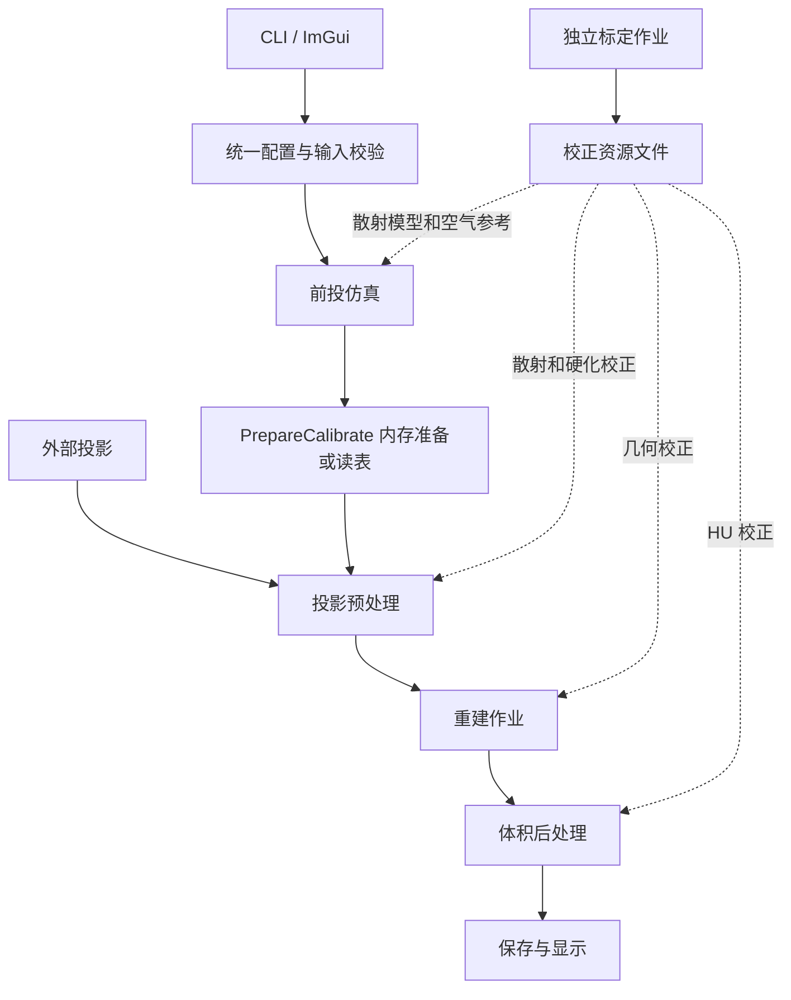
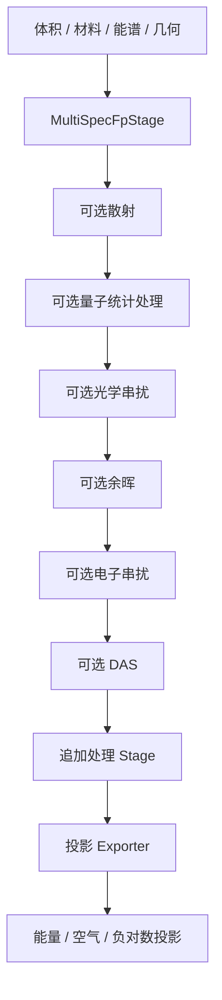
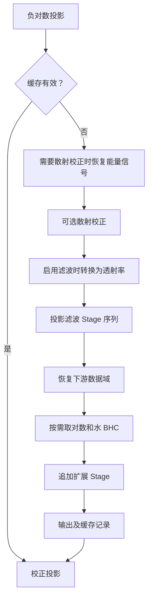
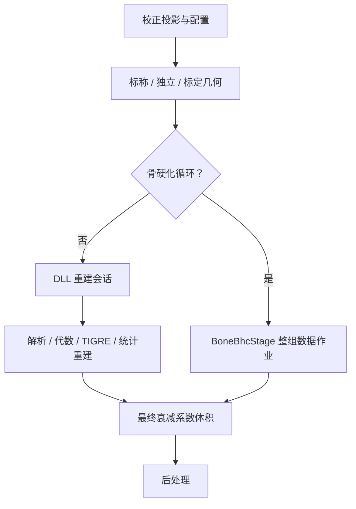
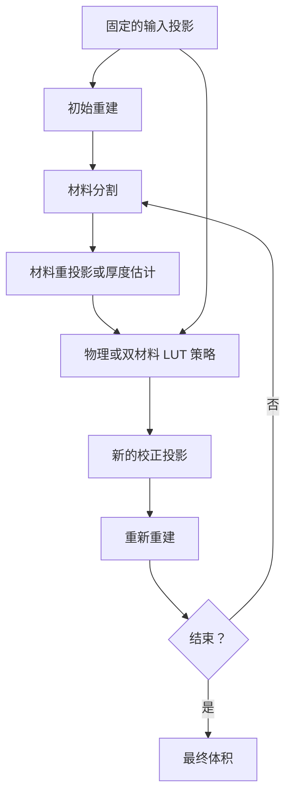
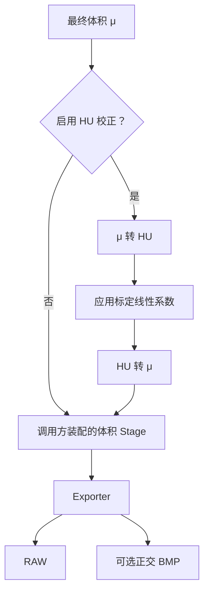
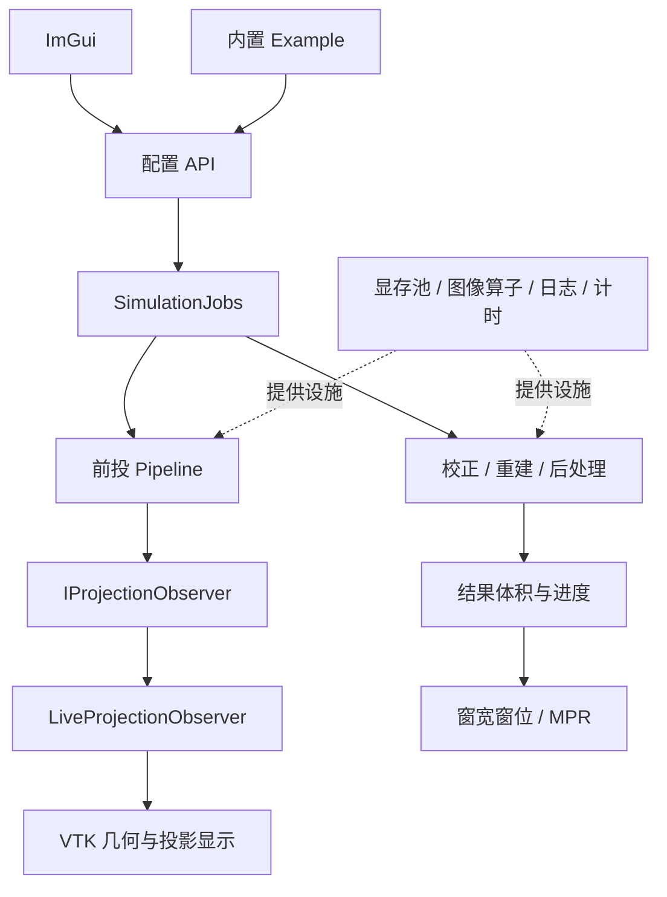

# 架构与处理流程

配置入口见 [README](README.zh-CN.md)，校正资源字段见 [标定产物](CALIBRATION-ARTIFACTS.zh-CN.md)。本文只维护源码边界、执行顺序和当前能力。

## 源码归属

`include/` 与 `src/` 按职责对应；目录分区不等于独立静态库。

| 分区 | 职责 |
| --- | --- |
| input | 配置、材料/能谱、体积 I/O、内置示例及标定资源 |
| projection | spectral 多能标签前投、scalar 浮点前投 |
| recon | backend 重建适配、preprocess 校正、bhc 骨硬化、postprocess 后处理、geometry 几何 |
| processing | stage 契约、image 算子、scatter 共用运算、device 显存池、support 日志进度 |
| client | ImGui 面板、作业控制、显示适配 |
| modules | 有独立 API 或可选边界的能谱、衰减、浮点前投和 VTK 组件 |
| app | 可执行入口、experiments 实验程序、plot 绘图工具 |
| tests | 对应业务测试；cpu 为不依赖 CUDA/VTK/重建 DLL 的入口 |

底层重建 DLL 不依赖本应用；计算核心不依赖客户端。公开引用写完整分区路径，私有辅助文件跟随实现。新增功能优先进入已有分区，不保留迁移路径的转发头。独立组件详见 [modules](modules/README.zh-CN.md)。

## 构建与依赖

根 CMake 查找依赖和装配组件；`Application.cmake` 定义应用，`Tools.cmake` 定义工具，`Tests.cmake` 定义测试。复用源码列表放 `ProcessingSources.cmake`，共用数值测试放 `NumericalTests.cmake`，matio SDK 查找放 `Findmatio.cmake`。源码显式列举。

Stage 为头文件契约；显存池、图像运算、自适应散射直接编译进使用者，不要求各建一个静态库。日志依赖 `yk::spdlog` 头文件目标，不借用 DLL 的 `src/util`。Eigen 用于水 BHC 的带主元 QR、双材料拟合和 EBHC 的 LDLT，业务拟合模型仍由对应模块维护。

应用使用 SDK 公共几何头 `include/YKCBCT/geometry/` 和重建入口，不包含底层私有算法头。白盒测试可单独依赖私有实现，不能将其搜索路径扩散到生产目标。

## 配置与任务边界

- `loadConfig` 读取 TOML、解析相对路径；`normalizeConfig` 补派生默认值。
- `validateConfig` 校验内存参数；`validateRuntimeInputs` 检查执行所需资源，数据内容由读取器验证。
- `saveConfig` 序列化当前参数，不依赖原文件或临时 TOML 往返。新增参数需同步解析、校验、保存和对应 UI。
- `SimulationJobs` 管理配置快照、后台重建、进度和异常；VTK 更新留在 UI 线程。
- `IProjectionObserver` 提供借用数据的同步通知；`LiveProjectionObserver` 适配显示。
- `reconstructWithLibrary` 统一解析、代数与统计重建入口；具体算法仍由 DLL 执行。

## 标定边界

库层的 PrepareCalibrate 在前处理前生产或加载校正资源，资源可留在内存，保存文件为可选操作；像素校正阶段不负责拟合。当前 UI 的 Calibrate 工作区单独保存标定状态，不向重建自动传递表或几何；UI 重建保留内置水 BHC 拟合，暂不使用几何、BHC 和双材料外部标定文件。水 BHC、HU 和几何表 I/O 位于 `input/calibration`；双材料与 EBHC 专用拟合靠近对应业务。水 BHC 标定任务当前仍使用扫描 TOML，并未提供独立任务配置。

资源保留各自类型、格式和验证规则。空气 RAW 尚无完整采集元数据，表与扫描条件匹配仍需使用者保证。文件结构、适用范围及缓存规则集中在[标定产物文档](CALIBRATION-ARTIFACTS.zh-CN.md)，这里不重复列字段。

## 当前业务链与 Stage 清单

以下区分默认装配、可选配置和仅通过 API 装配的能力；“有 Stage”不代表它已进入所有 TOML/UI 入口。标定资源的具体格式和读取方式见 [校正资源文件说明](CALIBRATION-ARTIFACTS.zh-CN.md)。

### 总体关系

标定生产可复用的资源，执行链读取资源。两者复用物理模型、图像算子、Eigen 求解和数据接口。带水板拟合配方的重建在准备阶段拟合；前处理本身保持只消费资源。水 BHC、几何和 HU 的文件读写在 `input/calibration`；双材料和 EBHC 的专用拟合靠近对应业务，仍在 `recon/preprocess/calibration`。这不是所有标定都已集中为同一个 UI 工作台。

### 前投

| 部分 | 实现边界 |
| --- | --- |
| MultiSpecFpStage | 实现 ISource，准备物理输入并生成批量投影 |
| 射线采样、焦点/散焦、路径遍历、多能积分、探测器响应 | Source 内部 Backend 的融合计算，不拆成独立 Stage |
| Scatter / Quantum / Crosstalk / Afterglow / DAS | 可选 IProjectionStage；光学和电子串扰是两个执行环节 |
| 量子噪声 | 主射线采样部分已融合在前投 kernel；后续 Quantum Stage 选择/补充统计结果，不能理解成全部噪声只在此生成 |
| 能量、空气与负对数输出 | Exporter |
| 显示通知 | IProjectionObserver，不是数值 Stage |

主路径可保持设备数据；Host 数据接入并不保证所有物理算子都有纯 CPU 实现。独立 `scalar_projection` 提供浮点体积前投，可供骨硬化重投影等调用，不重复执行完整探测器仿真。

### Preprocess

| 环节 | 当前能力 |
| --- | --- |
| Restore | 结合空气参考恢复 EnergySignal |
| Scatter | ASKS 校正；掩膜、引导、固定迭代或实验性自适应求解是内部策略 |
| TransmissionConversion | 在 LogAttenuation / EnergySignal 与 Transmission 之间转换 |
| 图像 Stage | 正式 filters 配置装配 mean、gaussian、guided；API 另有 bilateral、resample |
| Finalize | 取对数、水 BHC；水 BHC 使用预先准备的系数 |
| TwoMaterialBhc / EmpiricalBhc | 已有专用接口，带输入域及辅助数据要求，不是默认全部串入 |
| 缓存 | 外层管理；包括输入和校正资源身份，不是像素处理 Stage |

`Pipeline::append` 追加在内置校正链之后，不支持任意位置插入、自动排序或任意 DAG。要求水 BHC 之前执行的策略必须使用对应业务路由。最终输出须是负对数投影。

### Recon 与骨硬化作业

重建本身通过 `reconstructWithLibrary` 和 DLL 会话执行，尚未统一包装为普通 IStage。FDK/WFBP、SART/SIRT/OS-SART/CGLS、TIGRE 和统计重建属于算法后端；内部 TV 是算法内部插件，不是重建后的图像滤波。几何校正改变算法接收的几何描述，不直接扭曲像素。批量输入、显存预算和进度由会话及作业管理负责。

BoneBhcStage 是 Dataset 粒度的 IStage，注入策略及重建回调。物理方法支持水校正前/后输入；双材料 LUT 使用散射校正后、水 BHC 前输入。内部回调绕过外层骨硬化与输出 HU 校正，防止递归和重复补偿。BoneBhcStage、双材料校正、EBHC 等仍带实验性标记；接口完整不代表伪影改善已在所有扫描条件下验证。

### Postprocess

| 能力 | 接入程度 |
| --- | --- |
| μ/HU 相互转换、可变基准 | CPU/CUDA Stage API |
| 空气/水 ROI 标定 | Stage/API，属于独立标定任务；尚无完整 ROI 标定 UI |
| HU 线性校正读表 | 正式 TOML/UI 已接入，输出转回 mm⁻¹ |
| 多级 HU 阈值及标签 | Stage API，输出域为 Labels |
| 重采样、均值、高斯、双边、自引导 | Stage API；支持投影、体积逐层 2D 或空间 3D |
| 其他体积 Stage 装配 | PostprocessConfigurer；尚非完整 TOML/UI 流程编辑器 |
| RAW / BMP | Exporter |
| DICOM、通用 MAR | 未完成，不能按已有出口接口视为实现 |

### 客户端与公共设施

UI 编辑参数并发起作业，VTK 消费结果；计算核心不反向依赖 UI。观察回调在调用线程执行，不等于完全异步渲染。Example 准备输入和扫描配置；材料、XCOM、能谱属于数值输入模块；Eigen 和显存池是实现设施，不应为了形式统一而包装成业务 Stage。

### Stage 描述能力与边界

顶层是 IPlugin 以及 ISource、IStage、IOutput；业务链保留各自的 Data、Context、Domain。已有元信息查询、输入输出域和 Host/Device 契约、生命周期、Source 批容量、传输检查、计时及异常清理。

PluginInfo 包含 ID、名称、描述、版本、种类、分类、标签、提供者、文档、成熟度、弃用说明和参数描述。当前严格要求的是 ID、名称、种类；参数描述包含 key/name/description/type/unit，不是完整配置 schema。目录查询不代表对应实现已编译或注册。

当前足够支撑受控处理链，但尚不能自动完成：

- 根据参数默认值、范围、候选值、依赖关系生成完整 UI；这些结构化字段尚不齐全。
- 根据数据尺寸、布局、坐标轴、单位、几何改变自动证明连接合法。
- 根据逐帧/时序/整组数据及邻域依赖自动调度。
- 根据内存需求、并发约束、取消能力自动分配任务。
- 自动识别所有标定资源的适用采集条件。

后续若建设可视化处理图，优先补参数约束、数据规格、执行粒度和资源要求；不需要重新搭一套顶层模板框架。现有算法仍由各业务实现负责。
