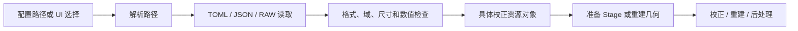

# 标定产物格式与读取

本文描述当前实现，流程与 Stage 关系见 [架构说明](ARCHITECTURE.zh-CN.md)。标定产物是可复用的校正资源，不是扫描任务 TOML，也不是诊断图片或结果报告。正常校正读取资源，不隐式重新标定。

## 格式总览

| 资源 | 格式及标识 | 读取入口 | 使用位置 |
| --- | --- | --- | --- |
| 水 BHC | TOML，format=water_bhc，version=1 | calibration::WaterBhcTable::load / resolveWaterBhc | preprocess 的水 BHC，及 HU 水参考 |
| HU 标定 | TOML，format=air_water_hu，version=1 | postprocess::HuCalibrationResult::load / makeHuCorrectionStage(path) | 体积 HU 线性校正 |
| 几何校正 | TOML，format=circular_geometry_correction，version=1 | calibration::loadGeometryCorrection | 重建几何 |
| 双材料 LUT | JSON，schema=two-material-bhc-lut-v1 | preprocess::TwoMaterialCalibration::load | 双材料骨硬化策略 |
| ASKS | JSON，format=fasks-runtime-model/v4，schema_version=4 | FasksRuntimeModel(path) | 散射仿真及散射校正 |
| 空气参考 | 无头 float32 RAW | 前处理空气输入读取器 | 能量恢复、归一化及散射校正 |

没有统一的万能表格式。TOML/JSON 由 toml++/nlohmann JSON 解析为具体结构体；参数经过校验后供 Stage 使用，CUDA 常量和缓冲由对应执行实现准备。Stage 不在每个像素上解析文件。路径相对扫描 TOML 所在目录解析；直接调用 C++ 读取器时，路径是调用方提供的路径，相对路径按进程工作目录解释。

## 水 BHC

标定命令：

```text
multispectrum_sim --calibrate-water-bhc scan.toml water.bhc.toml
```

输出水 BHC 表及 `water.bhc.toml.config.toml`（指向该表的扫描配置）。可从 UI 单独执行生成表操作。正常流程通过以下配置引用：

```toml
[reconstruction.preprocessing]
enabled = true

[reconstruction.preprocessing.beam_hardening]
enabled = true
calibration_file = "calibration/water.bhc.toml"
```

表的结构示例如下。**数字只演示格式，不能替代真实标定；真实扫描应使用标定命令产生的结果。**

```toml
format = "water_bhc"
version = 1
input_domain = "energy_integrating_log"
output_domain = "mono_log"
length_unit = "mm"
coefficients = [0.0, 1.0]
clamp_min = 0.0
clamp_max = 20.0
reference_energy_keV = 70.0
mu_water_mm_inv = 0.02
calibrated_max_water_mm = 400.0
provenance = "format illustration only"
```

`coefficients=[c0,c1,...]` 按升幂保存，校正为 `c0+c1*p+c2*p²+...`；表存系数，不存每个像素的校正值。系数数量决定阶数。读取器检查格式、版本、数值域、单位、系数数量 2～17、有限值、截断范围及正参考量。表中数值覆盖扫描配置里同名系数/参考参数；水参考直接使用表中的能量和 μ，不要求原始能谱仍存在。

`calibrated_max_water_mm` 记录标定覆盖厚度，当前不能自动证明每条混合材料射线都位于物理有效范围。`provenance` 是来源说明，不是完整的能谱/探测器一致性校验。

## HU 线性标定

独立标定：`fitAirWaterHu(measured_air, measured_water)` 或空气/水 ROI 标定 Stage；结果调用 `HuCalibrationResult::save(path)`。读取由 `HuCalibrationResult::load(path)` 完成，也可直接 `makeHuCorrectionStage(path, location)` 创建持有系数快照的 Stage。

下面是自洽的格式示例，测得空气 −900 HU、水 100 HU 时，通过偏移 −100 HU 映射到目标 −1000/0 HU。它不是头模体实测标定：

```toml
format = "air_water_hu"
version = 1
input_domain = "HU"
output_domain = "HU"
scale = 1.0
offset = -100.0
measured_air_hu = -900.0
measured_water_hu = 100.0
target_air_hu = -1000.0
target_water_hu = 0.0
air_voxels = 100
water_voxels = 100
```

公式为 `HU_out = scale * HU_in + offset`。读取器要求正有限 scale、有限 offset、顺序正确的空气/水锚点、非负样本计数，并验证系数确实将测量锚点映射到目标锚点。

正式配置：

```toml
[reconstruction.postprocessing.hu_correction]
enabled = true
calibration_file = "calibration/air-water-hu.toml"
```

正式流程在最终重建后执行 μ→HU→线性校正→μ，最终 RAW 保持 mm⁻¹。UI 在重建输出区选择表。内部骨硬化重建不重复应用。当前表未保存标定时的水 μ 基准；使用者必须保证标定与应用的基准一致。HU ROI 标定尚未形成完整交互 UI。

## 几何校正

`saveGeometryCorrection(path, geometry, rmse_px)` 保存；`loadGeometryCorrection(path, acquisition, max_rmse)` 加载。UI 的几何标定窗口可加载 `.geometry-correction.toml`，用于校正几何重建；该文件独立于详细诊断 JSON。

所有字段位于 TOML 顶层：

- 固定标识：`format="circular_geometry_correction"`、`version=1`、`length_unit="mm"`、`angle_unit="rad"`、`coordinate_frame="calibrated_scanner"`。
- 采集与质量：`rmse_px`、`views`、`detector_u/v`、`pixel_u_mm/v_mm`、`rotation_direction`。
- 11 个几何量：`sid_mm`、`sdd_mm`、`offset_u_mm`、`offset_v_mm`、`offset_n_mm`、`tilt_u_rad`、`tilt_v_rad`、`tilt_n_rad`、`source_offset_x_mm/y_mm/z_mm`。

仅支持整周平板圆扫描。读取时检查视角数、探测器尺寸、像素间距及 RMSE 上限；保留当前重建网格，使用标定扫描坐标系（起始角、起始 Z 和模体姿态清零）。它不是对任意扫描通用的逐帧轨迹文件。

目前不存在扫描 TOML 的通用 `geometry.calibration_file` 自动加载字段。通过 UI/API 读取后得到具体几何，再由重建入口使用；保存扫描配置时保存的是相应参数。

## 双材料 BHC LUT

`TwoMaterialCalibration::save/load` 使用 JSON。必要字段：

| 字段 | 含义 |
| --- | --- |
| schema | `two-material-bhc-lut-v1` |
| input_domain | `scatter-corrected-log-before-water-bhc` |
| bone_rows / projection_columns | 骨厚度行数 / 每行投影采样列数，均至少 2 |
| bone_step_mm | 相邻骨厚度间隔，骨厚度轴从 0 开始 |
| reference_energy_keV | 正数表示指定能量；0 用于未指定能量的经验切线目标 |
| target_water_mu_mm / target_bone_mu_mm | 目标材料衰减系数，单位 mm⁻¹ |
| minimum_log / log_step | 每行的投影起点和步长，各有 bone_rows 个元素 |
| target_log | 行优先展开的一维数组，长度 bone_rows × projection_columns |
| provenance | 来源说明 |
| method | 保存时生成的说明文本；加载校验依据为 schema、输入域和数值字段 |

第 b 行、第 j 列的输入投影为 `minimum_log[b] + j*log_step[b]`，目标值位于 `target_log[b*projection_columns+j]`；行对应骨厚度 `b*bone_step_mm`。应用时根据投影值和骨厚度插值，不能仅凭投影灰度查表。

加载检查数组长度、有限值、正步长、正材料衰减系数和每行目标值严格递增。当前 CPU `correct` 对骨厚度越界报错，对投影行端点之外采用端段线性外推；这不是采集条件自动匹配保障。

正式骨硬化路由使用：

```toml
[reconstruction.bone_hardening]
enabled = true
method = "two_material_lut"
calibration_file = "calibration/two-material.json"
```

这是局部配置示例，完整任务还需重建参数及初始水 BHC 参考。骨厚度来自分割和重投影或提供者接口。此策略仍为实验性能力。

## ASKS 散射模型

`FasksRuntimeModel(path)` 当前明确要求 v4，不能将任意名为 asks.json 的文件直接当作兼容模型。关键字段组：

- `format="fasks-runtime-model/v4"`、`schema_version=4`、`signal_domain="energy_deposition_per_pixel"`。
- `validity`：`transmission_min/max`，要求 0 < min < max < 1。
- `kernel_sampling`：`representation="discrete_radial_table"`、正的 `support_u_mm/v_mm`。
- `center_kernel.amplitude`：`interpolation="linear-log-attenuation"`、`log_attenuation_nodes`、`values`。
- `center_kernel.shape`：`family="discrete-radial-kernel"`、`radial_positions_mm`（256 个递增样本，从 0 开始）、`radial_density_nodes_mm2`（每个衰减节点一行）。
- `water_equivalent_thickness`：`interpolation="pchip"`、`log_attenuation_nodes`、`thickness_mm_nodes`。
- `fasks`：非负 `gamma_per_mm`、`wet_smooth_sigma_mm`。
- `edge_amplitude_window`：`model="paper-linear-distance-to-boundary"`、`boundary_scale`、`ramp_mm`。
- `detector_response`：`model="air-pencil-beam-scatter-per-primary"`、`scatter_kernel_per_primary`（奇数宽高、矩形、非负）。

正式前投引用 `projection.scatter.model_file`；校正引用 `reconstruction.preprocessing.scatter.model_file`。模型可共用，但添加散射与求解去散射是不同执行过程。当前加载器检查格式和数值结构，不自动证明文件与本次能谱、剂量及全部设备条件匹配。

## 空气 RAW

无文件头的 float32，按 `[view][row][column]` 连续排列，column 最快。允许一帧 `detector_v × detector_u`，或完整 `views × detector_v × detector_u`；前者广播至每个视角。字节数应为上述元素数乘 4；数值须正且有限。当前 Windows x64 输出为小端，文件自身不记录字节序、尺寸、单位或采集条件。

校正配置为 `reconstruction.preprocessing.scatter.air_projection_file`；需要保证空气值与待恢复/校正的投影在对应信号域和采集条件下匹配。不能把空气参考图误认为待减去的散射图。

## 加载、执行与缓存



文件在准备阶段加载，不在逐像素处理中读取。不同资源有自己的类型和验证规则，没有统一通用资源加载器。水 BHC 和 HU 已有明确版本/域检查，几何还有尺寸及质量检查；空气 RAW、跨资源采集条件等仍存在上述限制。

投影校正缓存使用相关配置与文件身份（路径、大小、修改时间等）；不是统一的内容哈希数据库。水 BHC、空气或散射模型变化会影响缓存，输出 HU 校正不应使投影缓存失效。几何文件读取产生几何参数，而非新增像素前处理。
